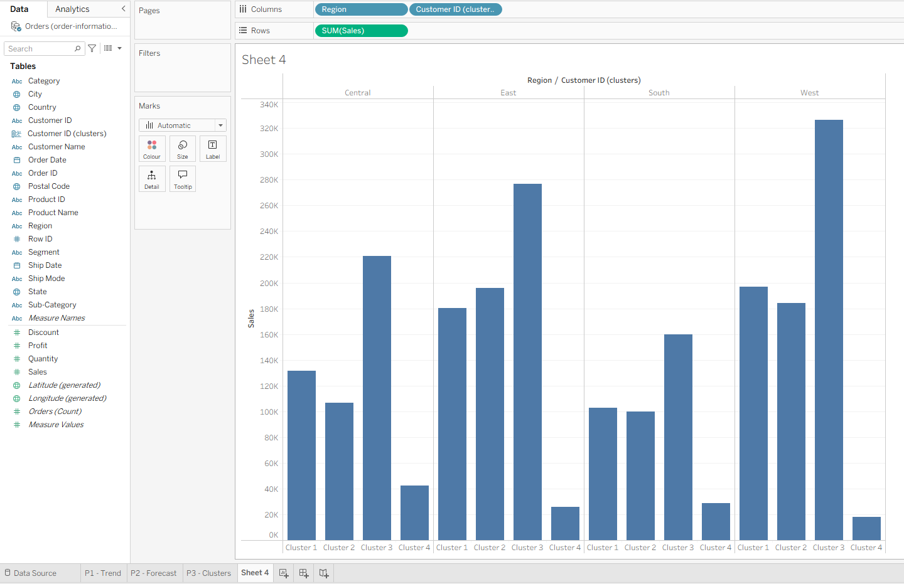

<div align="center">

# ITECH3102 - Big Data and Data Visualisation

**Federation University Australia | Comprehensive Coursework & Visual Analytics Portfolio**

[](https://federation.edu.au/)
[](LICENSE)
[](SECURITY.md)
[](https://public.tableau.com/)
[](https://d3js.org/)
[](https://developer.mozilla.org/en-US/docs/Web/JavaScript)
[](https://www.python.org/)

<p align="center">
  A curated collection of visual analytics solutions, executive business intelligence dashboards, and web-based graphic architectures developed for <b>ITECH3102 Big Data and Data Visualisation</b> at Federation University Australia.
</p>

</div>

> [!WARNING]
> ### Academic Integrity & Anti-Plagiarism Notice
> This repository is published strictly for portfolio review, technical demonstration, and personal academic archival.
> 
> Submitting any part of this code, report text, data models, or dashboard designs as your own academic work at Federation University Australia or any other institution constitutes severe academic misconduct (plagiarism and collusion). This repository is publicly indexed across global search engines, web crawlers, and academic similarity databases (including **Turnitin**). Any unauthorized submission will be detected automatically and flagged with 100% similarity against this timestamped and cryptographically GPG-signed public repository.

---

## Visual Showcase

<div align="center">

### Interactive Capstone Dashboard (Executive Overview)

<p><i>Figure 1.0: Executive Operations & School Performance Dashboard Suite (Authored by Sagar Biswas, Federation University Australia).</i></p>

<br/>

### Spatial Mapping & Statistical Clustering
<table>
  <tr>
    <td width="50%" align="center">
      <b>Geographic Choropleth Map with Dynamic Filter</b><br/>
      <br/>
      <i>Figure 1.1: Multi-scale geographic distribution view.</i>
    </td>
    <td width="50%" align="center">
      <b>K-Means Regional Clusters & Outlier Analysis</b><br/>
      <br/>
      <i>Figure 1.2: Four-cluster k-means model with statistical trendlines.</i>
    </td>
  </tr>
</table>

</div>

---

## Table of Contents

- [Overview](#overview)
- [Anti-Theft & Digital Provenance Protection](#anti-theft--digital-provenance-protection)
- [Key Highlights](#key-highlights)
- [Coursework Breakdown](#coursework-breakdown)
  - [Assessment Task 3: Exploratory Visualisation](#assessment-task-3-exploratory-visualisation)
  - [Assessment Task 4: Capstone Visualisation Project](#assessment-task-4-capstone-visualisation-project)
  - [Weekly Laboratory Modules (Weeks 1 to 8)](#weekly-laboratory-modules-weeks-1-to-8)
- [Repository Organization](#repository-organization)
- [Tech Stack & Tools](#tech-stack--tools)
- [Getting Started & Reproduction](#getting-started--reproduction)
  - [Prerequisites](#prerequisites)
  - [Opening Tableau Workbooks](#opening-tableau-workbooks)
  - [Running Web & D3.js Exercises](#running-web--d3js-exercises)
- [Citation](#citation)
- [Intellectual Property & Licensing](#intellectual-property--licensing)

---

## Overview

Data visualisation transforms complex, high-dimensional datasets into intuitive visual representations that support exploratory analysis, hypothesis validation, and executive decision-making. 

This repository documents the academic progression through **ITECH3102**, moving systematically from foundational web visual mechanics (HTML5, CSS3, DOM scripting, Scalable Vector Graphics, and D3.js) to advanced business intelligence workflows in Tableau (calculated fields, level-of-detail techniques, choropleth maps, forecasting models, and interactive parameters).

---

## Anti-Theft & Digital Provenance Protection

To protect the integrity of the coursework and prevent unauthorized redistribution or academic plagiarism, this repository incorporates multiple layers of digital provenance:

1. **Cryptographic Verification**: Commits in this repository are cryptographically signed with GPG, establishing an immutable, tamper-proof record of original authorship and exact creation timestamps.
2. **Embedded Source Provenance**: All HTML documents, CSS files, and Tableau XML workbooks contain embedded digital author comments and metadata tags registered to **Sagar Biswas** and **Federation University Australia**.
3. **Turnitin & Academic Crawler Indexing**: All written analyses, proposals, and design reports are indexed in global academic databases. Unauthorized copying triggers immediate similarity alerts.
4. **Dual Legal Licensing**:
   - Written reports, design documents, and bespoke workbook layouts are **All Rights Reserved**.
   - Source code is protected under **CC BY-NC-SA 4.0**, prohibiting commercial exploitation and requiring mandatory attribution.

---

## Key Highlights

- **Dual-Stack Visualization**: Blends programmatic web graphics (SVG, D3.js, HTML5) with enterprise BI platforms (Tableau Desktop / Tableau Public).
- **End-to-End Capstone Deliverables**: Includes formal requirements gathering, design plans, wireframe mockups, implementation analyses, and working `.twb`/`.twbx` workbooks.
- **Advanced Analytical Methods**: Implements polynomial trend regression, predictive time-series forecasting, k-means clustering, custom geocoding, and table calculations.
- **Fully Reproducible**: All datasets (CSV, Excel), design plans, reports, and code files are structured with relative linking for immediate offline or cloud reproduction.
- **Enterprise Standards**: Complete separation between raw datasets, exported graphics, source code, and workbook files with unified naming conventions.

---

## Coursework Breakdown

### Assessment Task 3: Exploratory Visualisation
- **Focus**: Exploratory data analysis (EDA) of student score distributions across subjects to evaluate performance disparities.
- **Tooling**: Tableau Desktop / Tableau Public.
- **Core Deliverables**:
  - [student_scores.csv](file:///o:/github/ITECH-3102-Data-Visualization/ITECH3102_Assessment%20Task%203_ClientX_StudentIDX/data/student_scores.csv): Cleaned multi-attribute dataset.
  - [ITECH3102_Visualizations.twb](file:///o:/github/ITECH-3102-Data-Visualization/ITECH3102_Assessment%20Task%203_ClientX_StudentIDX/tableau/ITECH3102_Visualizations.twb): Multi-sheet workbook with three visual encodings.
  - [ClientX_StudentIDX_AssessmentTask3.pdf](file:///o:/github/ITECH-3102-Data-Visualization/ITECH3102_Assessment%20Task%203_ClientX_StudentIDX/ClientX_StudentIDX_AssessmentTask3.pdf): Comprehensive report analyzing findings and visual choices.

### Assessment Task 4: Capstone Visualisation Project
- **Focus**: Design and deployment of an executive dashboard suite tracking educational equity, operational metrics, and student achievement across Massachusetts schools.
- **Tooling**: Tableau Desktop / Tableau Public.
- **Core Deliverables**:
  - [ClientX_StudentIDX_DesignPlan.pdf](file:///o:/github/ITECH-3102-Data-Visualization/ITECH3102_Assessment%20Task%204_ClientX_StudentIDX/ClientX_StudentIDX_DesignPlan.pdf): Detailed dashboard architecture proposal, stakeholder user stories, and wireframes.
  - [ClientX_StudentIDX_Implementation_AnalysisReport.pdf](file:///o:/github/ITECH-3102-Data-Visualization/ITECH3102_Assessment%20Task%204_ClientX_StudentIDX/ClientX_StudentIDX_Implementation_AnalysisReport.pdf): Exhaustive implementation report explaining visual interactions, KPI formulas, and policy takeaways.
  - [ITECH3102_AT4_ClientX_StudentIDX.twb](file:///o:/github/ITECH-3102-Data-Visualization/ITECH3102_Assessment%20Task%204_ClientX_StudentIDX/tableau/ITECH3102_AT4_ClientX_StudentIDX.twb): Production Tableau dashboard suite.

### Weekly Laboratory Modules (Weeks 1 to 8)

| Week | Module | Technology | Topics & Visual Techniques Covered | Key Deliverable |
| :---: | :--- | :--- | :--- | :--- |
| **01** | Tableau Onboarding | Tableau Public | Interface navigation, data connections (Excel/CSV), basic bar charts, saving and downloading `.twbx` files. | [Lab 1 Workbook](file:///o:/github/ITECH-3102-Data-Visualization/ITECH3102_Lab(1-4)_ClientX_StudentIDX/ITECH3102_Lab1_ClientX_StudentIDX/tableau/ITECH3102%20Lab%201%20-%20Borough%20Data.twbx) |
| **02** | Web Foundations | HTML5 & CSS3 | Document structure, Chrome DevTools workspace, inline/embedded/external stylesheets, typography, color models. | [Lab 2 Source](file:///o:/github/ITECH-3102-Data-Visualization/ITECH3102_Lab(1-4)_ClientX_StudentIDX/ITECH3102_Lab2_ClientX_StudentIDX/src) |
| **03** | DOM & Scripting | JavaScript | Browser console debugging, arrays, loops (`for`, `while`), conditional branching (`if...else`), reusable functions. | [Lab 3 Source](file:///o:/github/ITECH-3102-Data-Visualization/ITECH3102_Lab(1-4)_ClientX_StudentIDX/ITECH3102_Lab3_ClientX_StudentIDX/src) |
| **04** | Vector Graphics & D3 | SVG & D3.js | SVG geometric primitives (circle, ellipse, rect, line, text), RGBA alpha opacity, local HTTP server setup, initial D3 template. | [Lab 4 Source](file:///o:/github/ITECH-3102-Data-Visualization/ITECH3102_Lab(1-4)_ClientX_StudentIDX/ITECH3102_Lab4_ClientX_StudentIDX/src) |
| **05** | Chart Topologies | Tableau | Sorted bar charts, dot plots, continuous time-series line charts with date hierarchies, binning, and histograms. | [Lab 5 Data](file:///o:/github/ITECH-3102-Data-Visualization/ITECH3102_Lab(5-8)_ClientX_StudentIDX/ITECH3102_Lab5_ClientX_StudentIDX/data) |
| **06** | Spatial Analytics | Tableau | Geographic roles, filled choropleth maps, custom map labels, conditional calculations (`CASE` and `IF...THEN...ELSE`). | [Lab 6 Data](file:///o:/github/ITECH-3102-Data-Visualization/ITECH3102_Lab(5-8)_ClientX_StudentIDX/ITECH3102_Lab6_ClientX_StudentIDX/data) |
| **07** | Table Calculations | Tableau | Multi-table joins, quick filters, ranking algorithms, grand totals, and percentage-of-total calculations. | [Lab 7 Data](file:///o:/github/ITECH-3102-Data-Visualization/ITECH3102_Lab(5-8)_ClientX_StudentIDX/ITECH3102_Lab7_ClientX_StudentIDX/data) |
| **08** | Advanced Analytics | Tableau | Linear and polynomial trend regression, forecasting models, k-means clustering, parameter controls for search and filtering. | [Lab 8 Data](file:///o:/github/ITECH-3102-Data-Visualization/ITECH3102_Lab(5-8)_ClientX_StudentIDX/ITECH3102_Lab8_ClientX_StudentIDX/data) |

---

## Repository Organization

```text
ITECH-3102_Big-Data-AND-Data-Visualisation/
│
├── .gitignore
├── CITATION.cff
├── LICENSE
├── README.md
├── SECURITY.md
│
├── ITECH3102_Assessment Task 3_ClientX_StudentIDX/
│   ├── ITECH3102-Assessment Task 3 Specification.pdf
│   ├── ClientX_StudentIDX_AssessmentTask3.docx
│   ├── ClientX_StudentIDX_AssessmentTask3.pdf
│   ├── data/
│   │   └── student_scores.csv
│   ├── img/
│   │   └── visualization[1-3].png
│   └── tableau/
│       └── ITECH3102_Visualizations.twb
│
├── ITECH3102_Assessment Task 4_ClientX_StudentIDX/
│   ├── ITECH3102-Assessment Task 4 - Capstone Project Specification.pdf
│   ├── ClientX_StudentIDX_DesignPlan.docx
│   ├── ClientX_StudentIDX_DesignPlan.pdf
│   ├── ClientX_StudentIDX_Implementation_AnalysisReport.docx
│   ├── ClientX_StudentIDX_Implementation_AnalysisReport.pdf
│   ├── data/
│   │   ├── assessment task 4-data1-school-info.csv
│   │   └── assessment task 4-data2-order-info.xlsx
│   ├── img/
│   │   └── ss_*.png (dashboard and filter captures)
│   └── tableau/
│       └── ITECH3102_AT4_ClientX_StudentIDX.twb
│
├── ITECH3102_Lab(1-4)_ClientX_StudentIDX/
│   ├── ITECH3102_Lab(1-4)_ClientX_StudentIDX.docx
│   ├── ITECH3102_Lab(1-4)_ClientX_StudentIDX.pdf
│   ├── ITECH3102_Lab1_ClientX_StudentIDX/ (data/, img/, tableau/)
│   ├── ITECH3102_Lab2_ClientX_StudentIDX/ (img/, src/)
│   ├── ITECH3102_Lab3_ClientX_StudentIDX/ (img/, src/)
│   └── ITECH3102_Lab4_ClientX_StudentIDX/ (img/, src/)
│
└── ITECH3102_Lab(5-8)_ClientX_StudentIDX/
    ├── ITECH3102_Lab(5-8)_ClientX_StudentIDX.docx
    ├── ITECH3102_Lab(5-8)_ClientX_StudentIDX.pdf
    ├── ITECH3102_Lab5_ClientX_StudentIDX/ (data/, img/)
    ├── ITECH3102_Lab6_ClientX_StudentIDX/ (data/, img/)
    ├── ITECH3102_Lab7_ClientX_StudentIDX/ (data/, img/)
    └── ITECH3102_Lab8_ClientX_StudentIDX/ (data/, img/)
```

---

## Tech Stack & Tools

- **Analytics & BI**: Tableau Public / Tableau Desktop (2020.2+)
- **Web Languages**: HTML5, CSS3, JavaScript (ES6+)
- **Graphics & Visualization**: Scalable Vector Graphics (SVG), D3.js (Data-Driven Documents)
- **Local Web Server**: Python 3 (`http.server`)
- **Documentation**: Microsoft Word (`.docx`), Adobe PDF (`.pdf`), Markdown (`.md`)
- **Data Formats**: Comma-Separated Values (`.csv`), Microsoft Excel (`.xls`, `.xlsx`), Tableau Packaged Data (`.twbx`, `.hyper`)

---

## Getting Started & Reproduction

### Prerequisites
- Install [Tableau Desktop](https://www.tableau.com/products/desktop) or [Tableau Public](https://public.tableau.com/) (free).
- Install any modern web browser (Google Chrome, Firefox, Safari, or Microsoft Edge).
- Python 3.x installed (optional, used for local web server).

### Opening Tableau Workbooks
1. **Lab 1 Packaged Workbook**: Open `ITECH3102 Lab 1 - Borough Data.twbx` directly. The data source is embedded inside the package.
2. **Assessment Task 3 Workbook**: Open `ITECH3102_Visualizations.twb`. The data connection automatically resolves to `../data/student_scores.csv`.
3. **Assessment Task 4 Capstone Workbook**: Open `ITECH3102_AT4_ClientX_StudentIDX.twb`. Data connections resolve to `../data/`.

### Running Web & D3.js Exercises
To prevent CORS restriction issues when loading external scripts and SVG templates, run a lightweight local HTTP server:

```bash
# Clone the repository
git clone https://github.com/SagarBiswas-MultiHAT/ITECH-3102_Big-Data-AND-Data-Visualisation.git

# Navigate to Lab 4 source directory
cd ITECH-3102_Big-Data-AND-Data-Visualisation/ITECH3102_Lab(1-4)_ClientX_StudentIDX/ITECH3102_Lab4_ClientX_StudentIDX/src

# Launch local server
python -m http.server 8000
```

Open your browser and visit:
- `http://localhost:8000/index.html` (D3.js Template)
- `http://localhost:8000/circle.html` (SVG Circle Rendering)
- `http://localhost:8000/rgba.html` (RGBA Color Model Interaction)

---

## Citation

If you refer to this repository or utilize the dashboard architecture for academic or educational research, please cite it using:

```bibtex
@misc{biswas2026itech3102,
  author = {Sagar Biswas},
  title = {ITECH3102: Big Data and Data Visualisation Coursework Portfolio},
  year = {2026},
  publisher = {GitHub},
  howpublished = {\url{https://github.com/SagarBiswas-MultiHAT/ITECH-3102_Big-Data-AND-Data-Visualisation}}
}
```

Or click **Cite this repository** in the GitHub sidebar to generate standard APA or BibTeX citations.

---

## Intellectual Property & Licensing

- **Written Reports, Design Proposals & Assessment Deliverables**: Copyright (c) 2026 Sagar Biswas. All Rights Reserved. No permission is granted for academic submission, plagiarism, resale, or distribution to essay repositories or third parties.
- **Source Code**: Licensed under the [Creative Commons Attribution-NonCommercial-ShareAlike 4.0 International License (CC BY-NC-SA 4.0)](LICENSE). You may use and adapt the code for non-commercial educational study with mandatory attribution.
- **Academic Misconduct & Plagiarism Inquiries**: For questions regarding IP rights or reporting unauthorized duplication, refer to [SECURITY.md](SECURITY.md).
